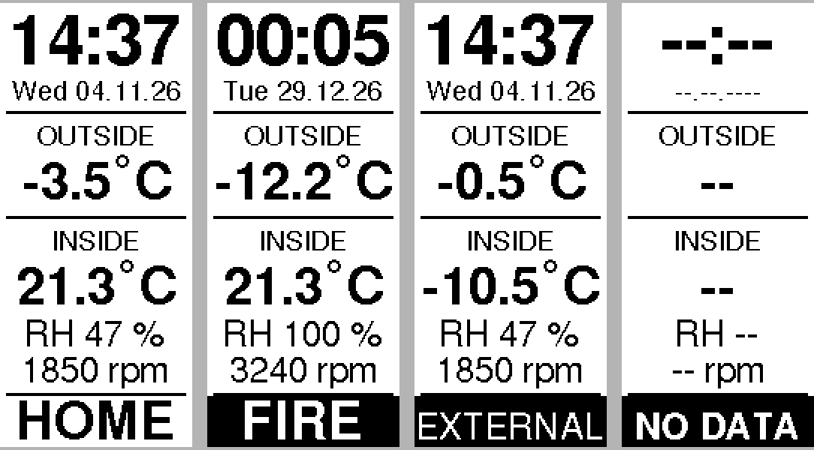
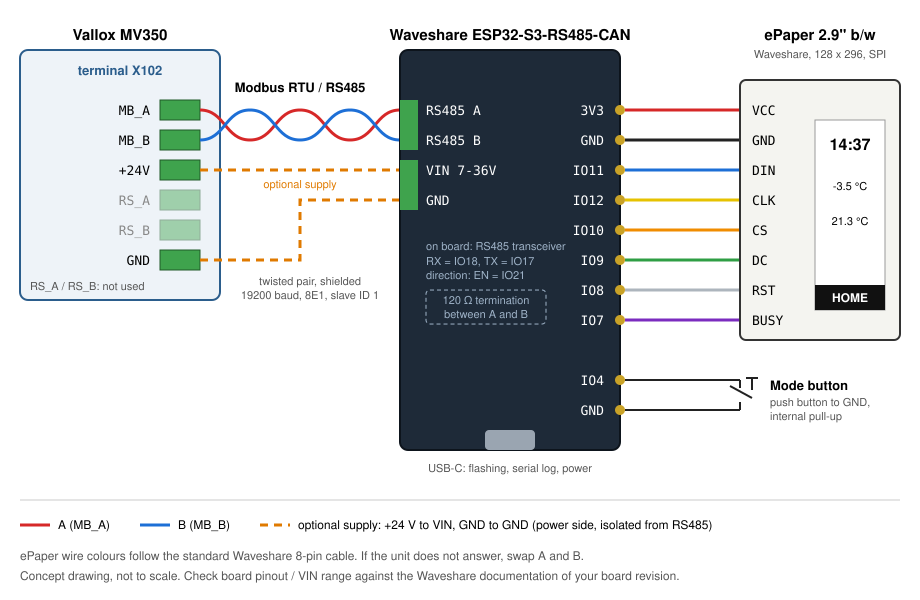

# Vallox MV350 controller (ESP32-S3 + 2.9" black/white ePaper (Waveshare, partial refresh))

Portrait display 128x296: time, date, outside temp, inside temp, RH, fan rpm, current mode.
One button steps through the modes (Home -> Away -> Boost -> Fire(place)); the mode is sent
to the unit 2 s after the last press (`BUTTON_SETTLE_MS`).

All settings (pins, modes, timer minutes, update timing, dead bands) are in `include/config.h`.

## Display layout

From left to right: normal operation, a timed attention mode (white on black), the mode started
by the unit's own digital input (`EXTERNAL`) and the screen when the unit cannot be read.

## Wiring

ePaper: VCC 3V3, GND, DIN IO11, CLK IO12, CS IO10, DC IO9, RST IO8, BUSY IO7.
Button: IO4 to GND. Check that none of these pins is used by the RTC chip of your board.

### Modbus connection to the Vallox unit

| Vallox terminal X102 | ESP32-S3-RS485-CAN | Wire |
|---|---|---|
| `MB_A` | RS485 `A` | one wire of a twisted pair |
| `MB_B` | RS485 `B` | the other wire of the same pair |
| `+24V`, `GND` | `VIN`, `GND` (optional) | supply, only if the board is not powered over USB |

`RS_A` / `RS_B` on X102 are not the Modbus bus; leave them unconnected.

The board's RS485 side is galvanically isolated, so its `GND` next to `VIN` is not a reference
for A/B. The transceiver's direction is switched by the firmware on IO21 (`RS485_EN_PIN`).

Cable: shielded twisted-pair cable, e.g. CAT5/CAT6 (one pair for A/B) or LiYCY 2x2x0.5 mm².
Connect the shield to earth at one end only.
Put a 120 Ω resistor between A and B at the end of the bus (the Vallox manual shows it at the
last unit); on the board this is the 120R jumper (H2). With a short cable at 19200 baud it
usually works without one. If the unit does not answer, swap A and B first.

The unit's Modbus settings must match `include/config.h`: address 1, 19200 baud, even parity,
1 stop bit (set under *Expert settings -> I/O and bus settings -> Modbus settings* on the
MyVallox panel or in the web UI).

## Update behaviour
After a mode change / power-up the unit is read every 1 s for 20 s, then every 5 s for 5 min,
then once per minute right after the minute changes. The ePaper is redrawn only if a shown
value changed. Normal redraws are partial (~1.4 s, no flashing); a full redraw (~4 s, flashing)
is done at start-up, after a mode change, after 60 partial redraws and at least every 12 h.
Partial redraw contrast is set by `PARTIAL_DRIVE_REPEATS` (changed pixels) and `PARTIAL_HOLD_FRAMES` (fading of unchanged pixels) in `include/config.h`.
Attention states (Boost, Fire, External, Fault, Unit off) are shown white on black.

## Host test of the timing logic
    g++ -std=c++11 -Wall -Wextra -o scheduler_test extras/scheduler_test.cpp && ./scheduler_test
